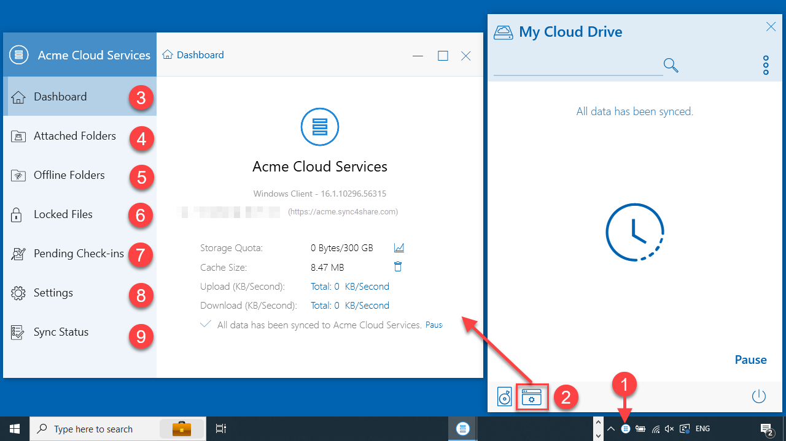
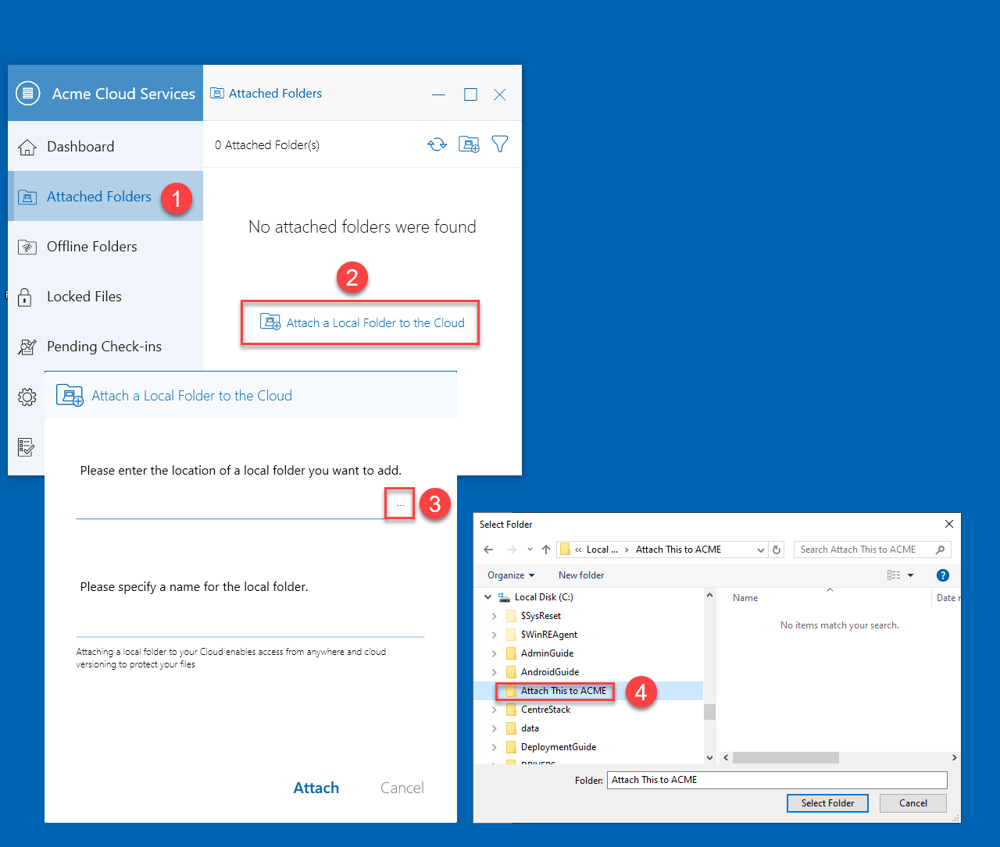
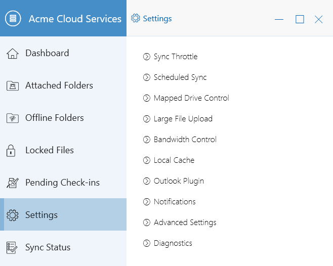
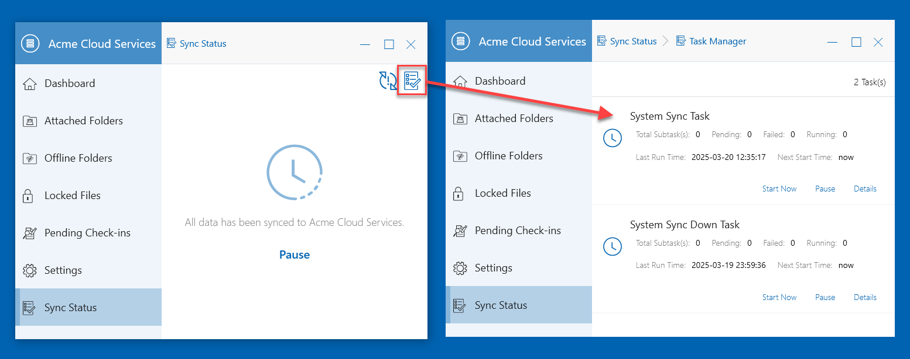
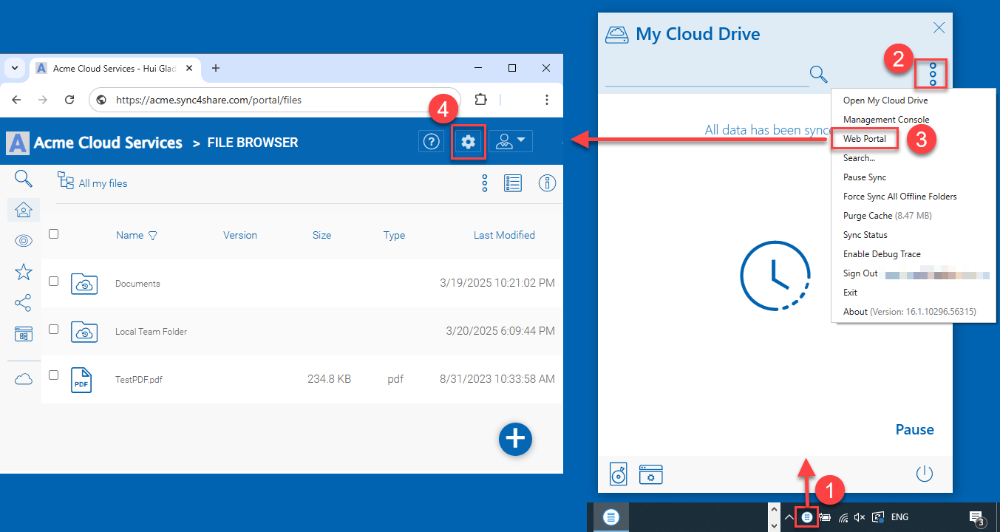
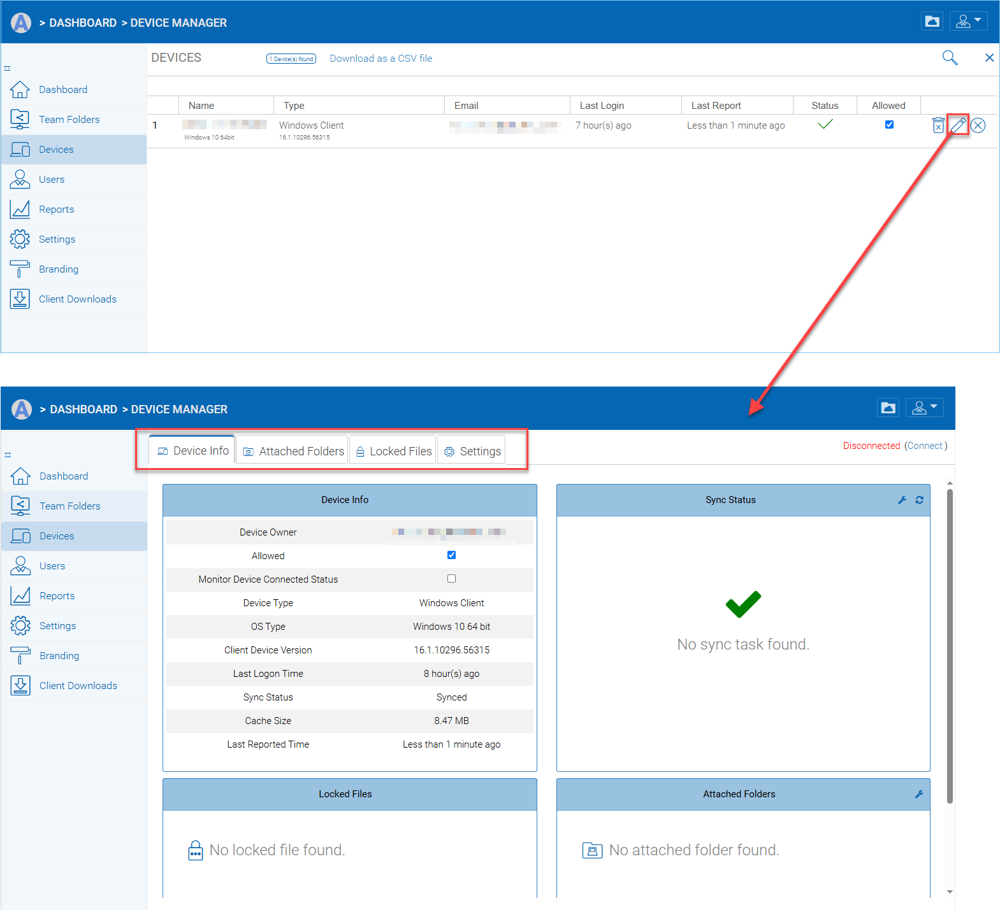
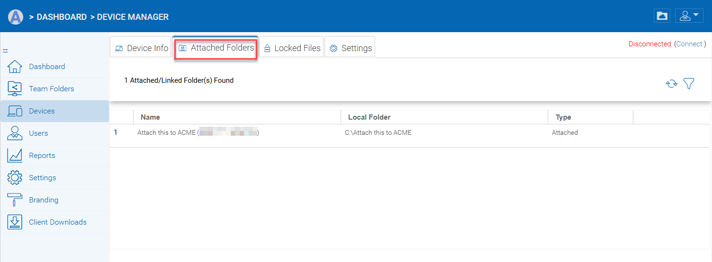
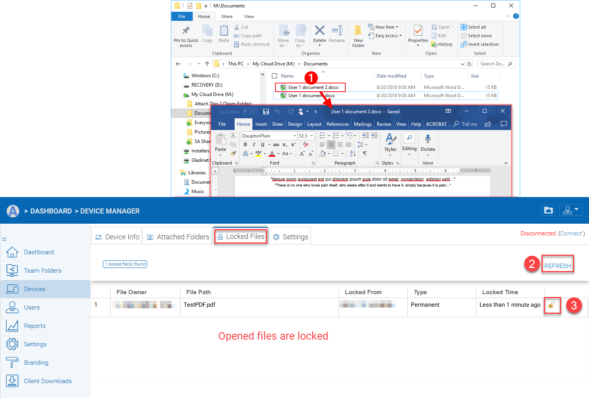
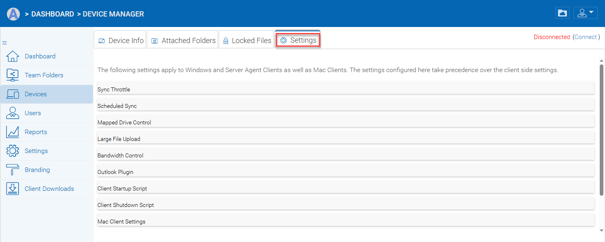

##################################
Client Side Management Console
##################################

Client Side Management Console - Native
==========================================

The desktop client has a management console that controls the client side of the behavior. The management console can be started from the system tray icon **(1)**. In the Client Menu, click on the management console icon **(2)**. 

        
    WINDOWS CLIENT MANAGEM ENT CONSOLE

The management console has seven sections:

   +--------------------------+-----------------------------------------------------+
   | Section Name             | Description                                         |
   +==========================+=====================================================+
   | Dashboard (3)            | Dashboard shows whether it is windows client/server |
   |                          | agent, the access point URL and the version.        |
   +--------------------------+-----------------------------------------------------+
   | Attached Folders (4)     | You will attach local folder to sync with Cloud,    |
   |                          | and also you can scan attached folder.              |
   +--------------------------+-----------------------------------------------------+
   | Offline Folders (5)      | All offline folders will be listed here.            |
   |                          | You also can enable offline access to a folder      |
   |                          | in this section.                                    |
   +--------------------------+-----------------------------------------------------+
   | Locked Files (6)         | All locked files will be listed here.               |
   |                          |                                                     |
   +--------------------------+-----------------------------------------------------+
   | Pending Check-ins (7)    | All checked-out files will be listed here.          |
   |                          | You also can check-out a file in this section.      |
   +--------------------------+-----------------------------------------------------+
   | Settings (8)             | Settings Manager stores the different client-side   |
   |                          | settings                                            |
   +--------------------------+-----------------------------------------------------+
   | Sync Status (9)          | Show sync status. You can pause the sync here.      |
   |                          | You observe summary of all the sync tasks from      |
   |                          | task manager in this section.                       |
   +--------------------------+-----------------------------------------------------+

Attached Folders
====================

You can attach local (from your Client Device) folders to |prodname| by clicking the "Attached Folders" button **(1)**. In the main view, and then click "Attach a Local Folder to the Cloud" **(2)**. This will open a wizard. Type in the location of the folder in the provided field or click the "..." button **(3)** to explore to a folder you wish to attach **(4)**. Click "Attach" to complete the process. 

        
    ATTACH A FOLDER TO BACKUP

Settings Explained
=====================

There are many settings under the Settings Manager in the desktop client. To access them click the Settings tab. 

        
    SETTINGS TAB - SETTINGS MANAGER

Sync Throttle
==================

    False (default) - If true, the Upload and Download Throttling control defined under this settings.

Sync Throttled Upload Bandwidth (KB/s, 0-Unlimited)
-----------------------------------------------------

    0 (default) - The default setting is unlimited KB/s, enter a number here to reduce the bandwidth consummed to the set limit.

Sync Throttled Download Bandwidth (KB/s, 0-Unlimited)
-------------------------------------------------------

    0 (default) - The default setting is unlimited KB/s, enter a number here to reduce the bandwidth consummed to the set limit.

Full Speed Sync Stop Hour (default 7:00)
------------------------------------------

    7 (default) - This setting represents the hour (24 hour clock) of the day when Full Speed synchronization will stop - Usually it is desired to have full speed synchronization overnight when the Internet utilization is low.

Full Speed Sync Start Hour (default 20:00)
---------------------------------------------

    20 (default) - This setting represents the hour (24 hour clock) of the day when Full Speed synchronization will begin - Usually it is desired to have full speed synchronization overnight when the Internet utilization is low.

Scan local files and sync-up to cloud as necessary
----------------------------------------------------

    False (default) - The desktop client builds up a state database that describes which files are in sync and which files are not. In the case where the desktop client is re-imaged, the state information may be lost. This option can be used to scan local files and upload them to the cloud as necessary. This is a quick way to re-build state information when the local files are more accurate than the information in the cloud.

Scan cloud files and sync-down to local as necessary
------------------------------------------------------

    False (default) - The desktop client builds up a state database that describes which files are in sync and which files are not. In the case where the desktop client is re-imaged, the state information may be lost. This option can be used to scan local files and upload them to the cloud as necessary. This is a quick way to re-build state information when the cloud files are more accurate than the local files.

Allow shortcuts to sync
-------------------------

    False (default) - By default, the Windows Client does not support file/folder shortcuts, as we cannot guarantee that the shortcuts in the cloud are always valid. If a user creates a shortcut from a computer and links to a local file. The shortcut is then uploaded to the cloud. If the user accesses the Windows Client from another computer, the shortcut will not work unless both computers have exactly the same files and folder structures. If the shortcut is broken, Windows Explorer will aggressively try to resolve the broken shortcut paths, which will slow down the Windows Client. If users only access their cloud files from the same computer/device, they may still want to save their shortcuts to the cloud. In this case, you should enable the "Allow shortcuts to sync" setting.

Disable file-change logs for dummy files (zero byte files)
-----------------------------------------------------------

    False (default) - When set to True, sync will ignore file change log for empty files. 

Scheduled Sync
=================

Enable Scheduled Sync
----------------------

    False (default) - If true, the synchronization and transferring of files will follow the schedule defined in this section. 

Pause Sync Start Hour (default 7:00)
----------------------------------------

    7 (default) - This setting represents the hour (24-hour clock) of the day when synchronization will pause.

Pause Sync End Hour (default 20:00)
------------------------------------

    20 (default) - This setting represents the hour (24-hour clock) of the day when synchronization will start.

Mapped Drive Control
=====================

Always allow PDF preview
-------------------------

    False (default) - If true, always allow windows client to show PDF file preview.

Do not show storage quota
--------------------------

    False (default) - If true, do not show the user's storage quota on windows client drive.

When starting up the client, open the mounted drive automatically
------------------------------------------------------------------

    True (default) - When starting up the client, automatically open File Explorer to show the windows client drive.

Cloud drive label
-------------------

    My Cloud Drive (default) - This is the drive label you can see from the Windows Explorer.

Drive Letter
--------------

    M (default) - This is the drive letter assignment.

In offline-mode, only show files that are cached and available locally
-----------------------------------------------------------------------

    False (default) - If true, when working in offline mode, only show files that are already in cache. Hide any files are not in cache.

Disable "check-out" on files and folders
-----------------------------------------

    False (default) - If true, disable manual file lock/unlock.

Use Windows' default browser to open files and folders
--------------------------------------------------------

    False (default) - If true, on windows client drive, when right click file/folder and select Open in Web Browser, open default browser to show the selected files. 

Always sync folder meta-data when browsing with Windows Explorer
-----------------------------------------------------------------

    False (default) - If true, when visiting cloud folder in windows client drive, the client will ignore local folder listing cahe. It will always get latest folder listing cache from cloud. It will generate high dir request to the server.

Disable drive mounting
------------------------

    False (default) - If true, no Cloud Drive will be mounted under My Computer for the Windows Client.

Create cloud drive shortcut under My Documents
------------------------------------------------

    True (default) - If true, there is a shortcut to the Cloud Drive under the My Documents' folder.

Large File Upload
=======================

Enable "chunking" when uploading files larger than a specific size (MB)
------------------------------------------------------------------------

    15 (default) - When uploading large file, the client can split the file in small chunks and upload small chunks in parallel. It can improve the upload speed. Also if a chunk fails, only need to retry the chunk. This setting defines how large the file size is to enable the chunk feature.

Default file chunk unit size (MB)
----------------------------------

    20 (default) - This setting defines the chunk size.

Bandwidth Control
=======================

Download Bandwidth Limit (KB/s, 0-Unlimited)
----------------------------------------------

    0 (default) - This setting is defaulted to unlimited. Change this to limit your download bandwidth to the number you enter in Kilobytes.

Upload Bandwidth Limit (KB/s, 0-Unlimited) 
--------------------------------------------

    0 (default) - This setting is defaulted to unlimited. Change this to limit your upload bandwidth to the number you enter in Kilobytes.

Maximum number of file transfert threads
-----------------------------------------

    5 (default) - Use this setting to restrict the number of threads used during synchronization.

Local Cache
============

Cache Directory
-----------------

    C:\\Users\\username\\AppData\\Local\\gteamclient\\cache (default) - Use this setting to change the default location of the cache. 

Cache Size Limit (MB)
----------------------

    0 (default) - The default setting is zero which is unlimited. Set this to a different number to limit the cache to that size in MB. You can disable the cache (not recommended) using the Web Portal's Tenant Dashboard > Roles settings.

Minimum free disk space (GB)
----------------------------

    5 (default) - The cache will leave defined free disk space on the disk. This can prevent the cached files use the entire disk. If zero, the cache can take entire disk space. 

Outlook Plugin
==================

Prompt for conversion when a file is larger than a specific size (KB)
------------------------------------------------------------------------

    0 (default) - Default to never prompt. This setting defines how large the attachment file size is to use the Outlook plugin to automatically upload the file to Centrestack cloud.

Attachments cache folder
----------------------------------

    Outlook plugin will upload file to the defined folder.

Link expiration time
----------------------------------

    Never (default) - When attaching a file to an Outlook email, the Windows Client can upload the file to the cloud and generate a link to access the file. The link is added in the email, to reduce email size. This setting defines how long the link will expire.

Notifications
==================

Disable offline-mode notification
----------------------------------

    False (default) - A system that goes into offline mode will send a notification by default. Change this to True to hide that notification. 

Disable File-change notification
----------------------------------

    False (default) - When files are modified by other people or by the same user but from another machine, there is a file change notification. Change this setting to True to turn off that notification.

Disable large file-download tracker window
----------------------------------------------

    False (default) - When Windows Explorer is downloading a large file in the background, by default there is a large file download progress dialog showing. This setting allows you to turn off that notification.

Disable automatic task tracker for scheduled tasks
---------------------------------------------------

    False (default) - By default, there is an automatic task tracker for scheduled tasks. This setting allows you to turn off the tracker.

Disable in-place-editing and preview-disabled notifications
-----------------------------------------------------------

    False (default) - When in-place-editing zip/exe file and preview-disabled, by default, the system will send a notification. This setting allows you to turn off that notification.

Disable shut-down confirmation
-------------------------------

    False (default) - When shutdown the desktop client, there is a shutdown confirmation window. This setting controls whether that confirmation dialog will be shown. Set this to True to hide the confirmation dialog. 

Disable folder move confirmation
---------------------------------

    False (default) - When moving a folder within windows client drive, by default, the system will show a confirmation dialog. This setting allows you to turn off that confirmation dialog.

Advanced Settings
=================

Enable in-place opening of zip and exe files
---------------------------------------------

    False (default) - By default, Windows Client doesn't allow a user to open zip files in mounted M drive directly. This is because opening a zip file means to download the whole zip file to cache first. When the zip file is big, the download will generate high network traffic and cause windows explorer to slow down. Change this to True if you want users to be able to open Zip files within the M drive. The next setting determines the size limit of this feature.

Max size of zip files allowed to open in-place (MB)
----------------------------------------------------

    20 (default) - This defines the size limit for the zip file the user is allowed to open. It is designed to prevent user/windows explorer from downloading very large zip files. By default, it is 20M. When admin enables inplace zip file opening, only files within 20M can be opened. 

Max size of files for thumbnail generation (MB)
---------------------------------------------------

    0 (default) - This defines the file size limit for generating thumbnail.

Always allow picture previews
-------------------------------

    False (default) - If this is turned on preview thumbnails will be generated for your local files. This consumes a lot of bandwidth for unnecessary downloading of image files. 

Enable slow network mode
--------------------------

    False (default) - No further information. 

Prevent computer from falling asleep during sync
-------------------------------------------------

    True (default) - Nighttime is typically a good time to transfer files at full speed. However, the machine may go into a sleeping state, preventing the transfer of files. This setting can prevent the sleep mode from activating. 

Mount drive in global space
-----------------------------

    False (default) - No furter information. 

Upload hidden files
---------------------

    False (default) - Change this setting to True if you want to upload Hidden Files to the cloud. 

Upload system files
---------------------

    False (default) - Change this setting to True if you want to upload System Files to the cloud. 

Use Volume Shadow-Copy to upload files that are constantly accessed
--------------------------------------------------------------------

    False (default) - By default an actively opened file will not be uploaded until it has been closed. This setting can override that behavior, uploading all of the files regardless of their open status.  

Disable AutoCAD optimization
------------------------------

    False (default) - By default, windows client will delay the sync of AutoCAD files by combining several changes into a single change. This is specific for users who save frequently or have the AutoCAD autosave feature enabled with short intervals. The file change will not be uploaded to the cloud immediately after the file saving. Leave it Uncheck if only one person is working on the AutoCAD files. When the setting is checked, windows client will sync the file to cloud as soon as the file is saved. Check the setting if the user needs the change to be uploaded to cloud as soon as possible. When multiple users are working on same set of AutoCAD files, check the setting.

Diagnostics
===========

Days of audit trace to keep
-----------------------------

    5 (default) - This setting defines how many days to keep the audit trace. 

Trace Level (0-Disable, 1-error, 2-warning, 3-info, 100-verbose)
------------------------------------------------------------------

    0 (default) - By default, the trace level is 0. It can be changed to the levels shown, or 101 for maximum debug trace. 

Sync Status
=============

Task Manager
---------------------

Click on the Task Manager icon on top right corner of client menu to open Task Manager. You can see the summary for all the sync tasks.

        
    TASK MANAGER

Client Side Management Console - Web Portal
===========================================

Click the system tray icon (1) open the tray menu. From the three-dots (2) you can access other functions. By choosing "Web Portal" (3), the Windows client web portal will be opened in a default web browser. Click "Management Console" icon (4) to access management console from web.

        
    ACCESS MANAGEMENT CONSOLE WEB PORTAL

Device Information
---------------------

Device Manager has an overview of the device including details such as Device Owner, Device Type, OS Type, Device Client Version (software build number), Last Login Time, Sync Status, Cache Size, Last Report Time, and more. Click "Manage" icon to see Device details.

        
    CLIENT MANAGEMENT CONSOLE - DEVICE MANAGER

Attached Folders
------------------

Attached Folders are local folders that are maintaining a two-way synchronization relationship with cloud storage. 

        
    ATTACHING A FOLDER TO THE CLOUD

Locked Files
---------------

A file that is in use is locked. In the image below, the user has opened the document **(1)** in Word. When a user is editing a Word Document, that file will remain locked while it is open in Word. Sometimes you will need to click the "Refresh" text **(2)** to see files that are locked in the Locked Files view. These are locked files from the local device. The locked files include automatically locked files (e.g., opened in Word) and manually locked files (e.g., right-clicked and locked in context menu). If you need to force-unlock a file, this can be done using the lock icon **(3)**. 

        
    LOCKED FILES VIEW

Settings
------------

Settings are settings that can be applied to the current device.

        
    CONSOLE SETTINGS
